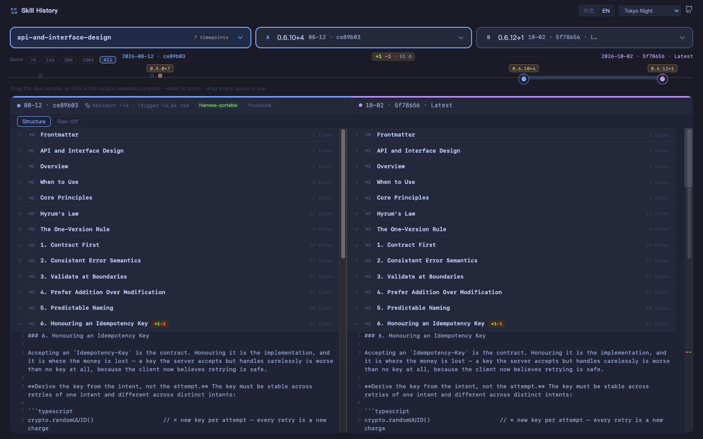

<div align="center">

# Skill History

**Agent Skills 的时光机。**

[](https://ohwald.github.io/skill-history/)
[](https://ohwald.github.io/skill-history/)
[](https://ohwald.github.io/skill-history/)


[🚀 在线体验](https://ohwald.github.io/skill-history/) · [English](README.md)



*版本模式 — `api-and-interface-design` @ 0.6.10 vs @ 0.6.12,在顶部时间轴上任意取两点。*

</div>

## 这是什么?

**Agent Skills** 是编码 agent 携带可复用上下文的方式——一个 `SKILL.md` 加脚本和参考资料,由 Claude Code、Codex、Cursor 等按需加载。Skill 像代码一样有版本,但一直没有什么办法看清它到底在怎么变。

Skill History 就是这个生态的一扇只读窗口:

- **任意两个 skill 并排深读**——真 diff 编辑器 + 贯穿双列的结构目录,不是两根滚动条。已收录 24 个源、1,170+ 个 skill,从 [anthropics/skills](https://github.com/anthropics/skills) 到社区合集。
- **重放一个 skill 的历史**——每个 skill 都是一条 commit 时间轴(带上游 tag 标注);拖动双滑块取任意两点,看清版本之间到底改了什么。
- **采纳前先审视**——每个 skill 的上下文成本(tokens)、行数、安装量、star、分类、许可,以及「也见于」镜像列表。
- **看生态怎么动**——所有源每天重新采集生成新快照,站点追踪的是生态,不是一次性导出。

许可感知:宽松许可的 skill 全文展示;专有/未声明的降级为「仅元数据 + 来源链接」,绝不转载原文。

纯 Python stdlib 管线 + 零构建单文件前端(vanilla JS + Monaco via CDN),无运行时依赖。

## 功能

- **并排对比**:Monaco diff 编辑器(CDN 不可达时自动回退纯文本双栏),A/B 身份色贯穿槽位与列头
- **版本对比**:每个槽位都是「skill @ 时间点」——任意一侧可选任意 commit(带上游 tag 标注);两槽选同一 skill 自动进入版本模式,附可点击的 commit 时间轴
- **结构化视图**:内容按官方 SKILL.md 约定分段(YAML frontmatter + 标题层级,代码围栏不拆散),结构目录一键跳转双列;一键切换原文 diff
- **许可感知**:宽松许可全文展示;专有/未声明 skill 降级(仅元数据 + 来源链接,不转载原文)
- **精选内容源**:24 个源,含 [anthropics/skills](https://github.com/anthropics/skills)、[obra/superpowers](https://github.com/obra/superpowers)、[mattpocock/skills](https://github.com/mattpocock/skills)、wshobson/agents、firebase/agent-skills、prisma/skills、supabase/agent-skills 等(扩源改配置即可)
- **六套编辑器主题**:Tokyo Night(默认)、Catppuccin Mocha、One Dark Pro、GitHub Light、One Light、Solarized Light;界面中英双语

## 快速开始

```bash
# 采集全部内容源(单分支全历史)
python3 -m pipeline.collect

# 构建(版本轴 + 可选联网辅助数据)
python3 -m pipeline.build --real --out site --fetch-aux

# 本地预览
python3 -m http.server 8765 -d site
```

无网络演示模式:

```bash
python3 -m pipeline.build --fixtures fixtures --out site
```

需要 Python ≥ 3.11(纯 stdlib)与 `git`。

## 测试

```bash
python3 -m pytest -q
```

唯一正式测试 seam 是 Python 管线(frontmatter 解析、许可分流、Canonical 去重、版本轴提取、manifest 校验,含模拟上游的每日更新循环端到端用例);前端为零构建 vanilla JS,对照 `design-preview/` 人工验收。

## 架构

```
pipeline/
├── collect.py    # clone/fetch 内容源 + 辅助数据(marketplace 分类、skills.sh 安装量、stars)
├── parse.py      # SKILL.md frontmatter 解析 + 许可分流
├── manifest.py   # 遍历收录 + Canonical 去重(「也见于」)+ 内容指纹
├── versions.py   # 版本轴:per-path commit 历史(日期+短sha,tag 标注)
├── validate.py   # 构建期 manifest 校验(失败即构建失败)
└── build.py      # 单文件站点组装(manifest 内联 + 按指纹正文 + 六主题 CSS)
template/          # index.html + app.js(选择器 / 对比 / 降级 / 版本模式四态)
design-preview/    # 设计渲染图、主题截图、themes.json(色彩令牌)
```

数据流:`collect → parse → 许可分流 → Canonical 去重 → 版本轴 → validate → 单文件站点`。正文按内容指纹独立服务,切换对比只拉取变化的部分。

## 主题

[design-preview/themes.json](design-preview/themes.json) 是色彩令牌的唯一来源;构建时六套预设以内联 CSS 变量的方式写入,站点自带切换器。新增预设 = 加一条配置。

## 部署

- **Capture**(`.github/workflows/capture.yml`,每天 UTC 02:23 / 北京 10:23):质量门 → 重新采集 → 重建 → 提交 `site/`
- **Pages**(`.github/workflows/pages.yml`):push / capture 完成后将 `site/` 发布到 GitHub Pages

## 贡献

提交信息遵循 [Conventional Commits](https://www.conventionalcommits.org/),使用英文:

```
<type>(<可选 scope>): <祈使句摘要>
```

类型:`feat` `fix` `docs` `refactor` `test` `build` `ci` `chore`。示例:`feat(picker): filter skills by source`、`fix(build): fail on leftover template placeholders`。
